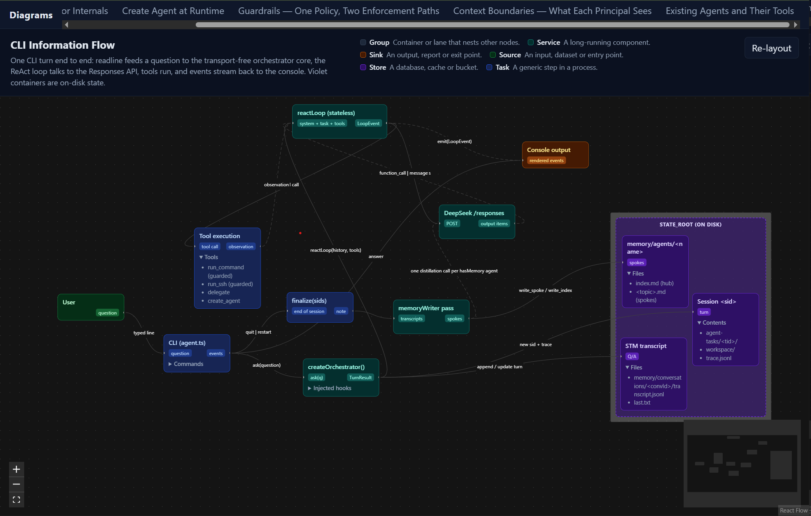

# Semantic JSON → Diagram Visualizer

Read-only viewer that turns a JSON file into an interactive, auto-laid-out
React Flow diagram. Drop a file in `src/diagrams/`, reload, done — no registry,
no coordinates to author, no code changes. Adjusting a node in the browser is
kept as a saved layout version (see below), never written back to the file.



See `docs/prd.md` for the full design.

To see examples copy diagrams from `skills/create-diagram-files/assets` to `src/diagrams/` and start app.


## Agent skill

You can use attached skill to have your agent generate and validate diagrams 
that show anything you need to see in your code IE architecture, information flow, class relations...
Your imagination is the boundary.

`skills/create-diagram-files/` is self-contained and can be copied into another
project. Point an agent at `SKILL.md`; it will write a diagram and run its own
validator:

```sh
npm run validate              # default src/diagrams/
npm run validate -- <dir>     # custom directory
npx tsx skills/create-diagram-files/scripts/validate.ts <dir>  # direct
npx tsx skills/create-diagram-files/scripts/validate.ts --self-test  # check the checker
```

`npm run validate` runs the `prevalidate` hook first, which materializes the
gitignored e2e fixture via `npm run fixtures` — the same step the Playwright
suite needs, so a fresh checkout validates and tests with no manual setup.


## Commands

```sh
npm install
npm run dev        # http://localhost:5173
npm run validate   # check src/diagrams/ (add `-- <dir>` for another dir)
npm run e2e        # Playwright end-to-end suite
npm run build      # tsc -b && vite build
```

## Layout versions

Layout is automatic, and authored JSON never needs coordinates. If you drag or
resize nodes, the arrangement is **autosaved** to `localStorage` under
`render-diagrams:layout-version:<id>` — there is no separate unsaved state, so a
reload or navigating away and back restores what you arranged. Each version is
scoped to one diagram id; other diagrams keep their own auto-layout. Saving is
silent on success; a failure (e.g. storage unavailable, an unreadable or
foreign upload) appears as a non-blocking notice over the diagram.

The actions live in the topbar's hamburger menu at the right end of the navbar;
the diagram title, description and kind legend live in the **Info** panel that
slides in from the left and overlays the diagram. Nothing takes space away from
the canvas, and there is no page header row.

| Action | Behavior |
|---|---|
| Drag / resize | Debounced autosave (silent on success). |
| **Download** | Exports the current geometry as `<id>.json` (portable, commitable). |
| **Upload** | Re-applies an exported `<id>.json`; a file for another diagram is refused. |
| **Reset layout** | Confirms in the menu, deletes the stored version, and re-runs ELK auto-layout. |

Recorded geometry is positions plus width for every node and height only for
containers/groups, so a saved leaf keeps growing when its sections expand. With
no saved version the page behaves exactly as before and the original
**Re-layout** item is shown in the menu instead of **Reset layout**.

## Adding a diagram

1. Write `src/diagrams/<id>.json` following `skills/create-diagram-files/references/schema.md`
   (or copy one of `skills/create-diagram-files/assets/*.json`).
2. `npm run validate` and fix any errors.
3. Reload the app. The file appears in the topbar with its own page at `/d/<id>`.

Malformed diagrams still appear in the topbar, marked `!`, and route to a page
listing their validation errors — a bad file never silently disappears.

## Layout

```
src/
  App.tsx            router + shell
  Topbar.tsx         derived from diagram metas
  DiagramPage.tsx    header + legend + ReactFlow + error panel
  loader.ts          Vite glob + parse + validate + sort
  nodes/             kind -> component registry and node bodies
  lib/               schema, kinds, palette, validate, ELK layout, flow builder, layout versions
  diagrams/*.json    the content
skills/create-diagram-files/  portable agent skill
  scripts/validate.ts         self-contained validator (no project imports)
```
